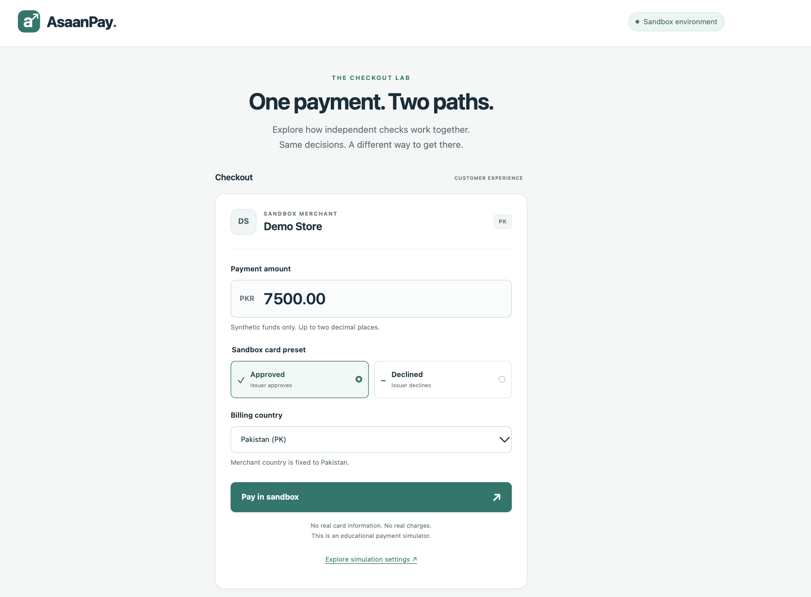
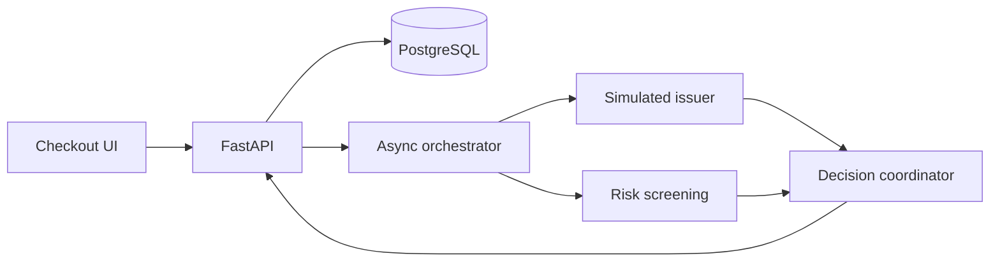
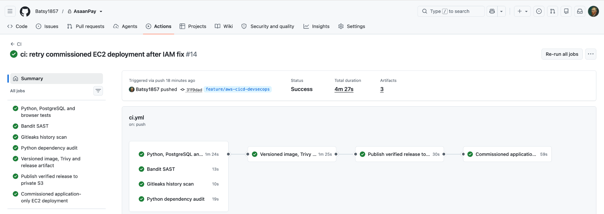

# AsaanPay

**A payment orchestration sandbox exploring asynchronous processing, reliable checkouts, and automated AWS deployment.**

AsaanPay is a full-stack DevOps project that simulates issuer authorization and rule-based risk screening for synthetic payments. It compares **sequential and concurrent execution** of independent checks while preserving the same checkout decisions. No real payments or external payment providers are involved.

## What I built

- **Payment orchestration:** FastAPI coordinates simulated issuer and risk checks using Python `asyncio`, with sequential and concurrent execution modes.
- **Interactive checkout:** A responsive interface displays payment outcomes and an **Architecture Explorer** visualizes execution timelines and compares both modes.
- **Reliable transactions:** PostgreSQL persists attempts and timing traces; atomic idempotency checks prevent duplicate processing, with retry handling for uncertain responses.
- **Rule-based screening:** Synthetic amount and billing-country rules can flag transactions for verification; issuer responses can approve or decline them.
- **Automated delivery:** GitHub Actions runs tests and security checks, builds a versioned Docker release, publishes it to private Amazon S3, and deploys to EC2 through AWS Systems Manager.

## Architecture

Both execution modes use the same decision rules. The application and PostgreSQL run as Docker Compose services on AWS EC2.

## Technology stack

| Area | Technologies |
| --- | --- |
| Application | Python, FastAPI, `asyncio`, HTML, CSS, JavaScript |
| Data | PostgreSQL, `asyncpg` |
| Containers | Docker, Docker Compose |
| CI/CD & security | GitHub Actions, Bandit, Gitleaks, pip-audit, Trivy |
| AWS | EC2, S3, IAM/OIDC, Systems Manager |

## CI/CD: from push to EC2

Every push to the configured deployment branch starts a pipeline that tests the application, checks dependencies and source code, builds and scans a release image, uploads verified artifacts to S3, and automatically deploys to EC2 using SSM.

[**View successful automated deployment — GitHub Actions run #14**](https://github.com/Batsy1857/AsaanPay/actions/runs/45021827985)

For implementation details, see the [architecture documentation](docs/architecture.md).
