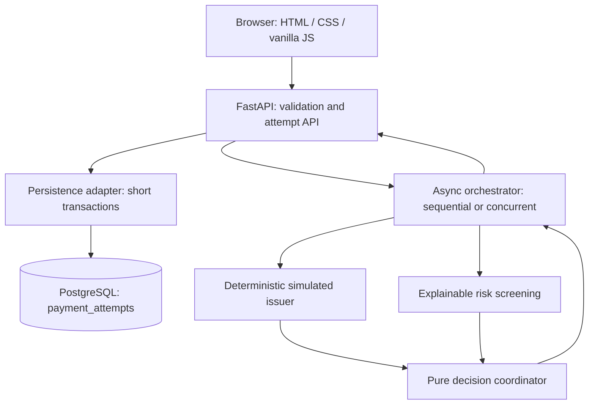

# AsaanPay architecture

## Scope and document status

AsaanPay is an educational synthetic payment-orchestration simulator for a DevOps software architecture assignment. Its purpose is to demonstrate how asynchronous orchestration changes latency while preserving deterministic decisions.

Milestone 1 implements only the FastAPI entry point, lifespan-managed asyncpg pool, database health endpoint, initial schema, Docker Compose setup, and minimal verification tests. Milestone 2 adds deterministic issuer/risk engines, immutable result contracts, and a pure decision coordinator. Checkout endpoints, orchestration, delays, UI, and benchmarks remain planned; implementation stops at Milestone 2.

The fixed scope is one FastAPI application, PostgreSQL, HTML/CSS/vanilla JavaScript, Docker Compose, two independent async simulator operations, and a pure decision coordinator. Both sequential and concurrent modes must implement the same decision semantics.

## Architecture and rationale

The browser calls the FastAPI application, which validates a request, reserves an attempt in PostgreSQL, executes the simulator operations, combines their results, and persists the outcome. The same application serves the static browser assets. Docker Compose will run one application service and one PostgreSQL service.



This is a logical component diagram, not a collection of services. A single process is sufficient to demonstrate `asyncio` scheduling without introducing networked services, a queue, or a worker system. The two branches use only immutable synthetic request data; neither reads the other branch's result or modifies shared state. The orchestrator owns scheduling, timeouts, cancellation, and timing. The coordinator owns only the decision matrix.

V1 uses exactly one application process/instance and one worker. PostgreSQL provides durable attempts and an atomic unique-key constraint, rather than relying on an in-memory duplicate check. Restricting database access to short transactions keeps artificial waits from occupying an open transaction or a borrowed database connection.

Sequential mode awaits issuer authorization and then risk screening. Concurrent mode schedules both branches before awaiting their results. Both branches run even if the issuer returns DECLINED: a business decline is a valid branch result, and a later technical risk failure must still make the attempt ERROR. A technical failure may stop remaining work, as described below.

Concurrency here means overlapping async branch lifetimes on the event loop. It does not imply parallel CPU execution or establish anything about real payment-system performance.

## Component contracts

| Component | Inputs | Outputs and obligations |
| --- | --- | --- |
| Request/API boundary | Idempotency key and proposed request body | Validate and normalize before creating an attempt; reject unknown fields; retrieve or reserve the durable attempt; serialize the stored result. |
| Persistence adapter | Normalized request, immutable fingerprint, state/result updates | Atomically reserve a unique key, compare duplicates, enforce allowed state changes, and persist trace/outcome with short transactions. Never start simulator work. |
| Simulated issuer | Synthetic card_preset; artificial delays deferred to Milestone 3 | Return the APPROVED or DECLINED enum. No database calls, randomness, external requests, or dependence on mode. May raise a technical failure. |
| Risk screening | Decimal amount_pkr and billing_country; artificial delays deferred | Return immutable status, ordered HIGH_VALUE/CROSS_BORDER reason codes, and readable evidence including triggered values and threshold/country comparison. No dependency on issuer output, database, current time, randomness, or mode. May raise a technical failure. |
| Async orchestrator | Attempt ID, normalized inputs, mode, workload profile, branch timeout policy | Schedule/await both branches; collect results and monotonic timings; translate technical exceptions/timeouts into failure markers for the coordinator; clean up started tasks. |
| Pure coordinator | Issuer and risk results, or explicit technical-failure markers | Return SUCCEEDED, DECLINED, VERIFICATION_REQUIRED, or ERROR according to the complete matrix below. No I/O, time access, state mutation, or knowledge of delays/mode. |
| Browser UI, later | Attempt API responses | Submit synthetic requests, show decisions and explanations, poll nonterminal attempts, and label every configured delay as artificial. |
| Benchmark runner, later | Fixed corpus, modes, profiles, fresh keys | Measure client API latency, retain server timing traces, check decisions, calculate overlap and summary statistics, and preserve raw results. |

The coordinator treats missing/invalid results as ERROR and gives explicit technical failures precedence over business results. The future orchestrator will capture exceptions/timeouts as typed markers and retain partial traces; the coordinator does not execute operations or catch runtime exceptions itself.

### Implemented fictional sandbox rules (Milestone 2)

Merchant country is fixed to `PK`. `card_preset` accepts `approved` and `declined`, mapping deterministically to APPROVED and DECLINED. Risk is VERIFY if `amount_pkr >= 50000` **or** `billing_country != "PK"`; otherwise CLEAR. Explanations must identify every triggered rule, observed value, and threshold/country comparison. These are fictional sandbox rules, not financial or fraud advice.

The storage choice for amounts is `NUMERIC(14,2)`: positive PKR amounts with at most two fractional digits, up to 999999999999.99. Future API validation must reject excess precision rather than let PostgreSQL round it. Billing country is normalized to two uppercase ASCII letters; V1 does not need a country registry. Mode, delay, IDs, and keys never affect branch results. Boundary checks should include 49999.99, 50000, and 50000.01, plus foreign-country cases below the threshold and cases triggering both rules.

Technical fault fixtures belong in the future validation harness; no public fault-injection API is planned.

## State machine and decision matrix

| Current state | Allowed next state | Meaning |
| --- | --- | --- |
| CREATED | PROCESSING | A durable attempt exists and its original creator is starting orchestration. |
| CREATED | ERROR | A technical failure prevents processing, or startup recovery identifies an interrupted attempt. |
| PROCESSING | SUCCEEDED | Issuer APPROVED and risk CLEAR. |
| PROCESSING | VERIFICATION_REQUIRED | Issuer APPROVED and risk VERIFY. |
| PROCESSING | DECLINED | Issuer DECLINED and a valid result from risk. |
| PROCESSING | ERROR | Any technical failure, timeout, or interrupted processing. |
| Any terminal state | None | Terminal decisions, errors, and traces are retained; duplicates do not transition them. |

SUCCEEDED, DECLINED, VERIFICATION_REQUIRED, and ERROR are terminal. CREATED and PROCESSING are nonterminal. There is no transition from ERROR back to PROCESSING and no verification-completion flow. A deliberately new experiment requires a new idempotency key.

| Issuer | Risk | State | Stable decision reason |
| --- | --- | --- | --- |
| APPROVED | CLEAR | SUCCEEDED | `APPROVED_AND_CLEAR` |
| APPROVED | VERIFY | VERIFICATION_REQUIRED | `RISK_REQUIRES_VERIFICATION` |
| DECLINED | CLEAR | DECLINED | `ISSUER_DECLINED` |
| DECLINED | VERIFY | DECLINED | `ISSUER_DECLINED` |
| Technical failure or timeout in either branch or orchestration | Any/absent | ERROR | Typed technical error; no business decision |

A technical error takes precedence even if the other branch has already returned DECLINED. The pure coordinator now implements all five rows using explicit BranchFailure markers for technical errors/timeouts, as required by Milestone 2. Translating runtime exceptions into those markers remains the future orchestration boundary's responsibility.

Equivalence means matching terminal state, business decision reason, and deterministic branch results/explanations for the same business inputs and workload/fault scenario. IDs, execution mode, timestamps, and timings naturally differ. Failure traces may contain different partial work because a sequential branch may not have started when a failure occurs. Equivalent deterministic fault cases must still end in ERROR in both modes.

## Proposed persistence and idempotency contract

Use one `payment_attempts` table. No separate issuer, risk, event-log, or benchmark tables are needed for the baseline.

| Proposed field(s) | Purpose and constraints |
| --- | --- |
| `id` | Server-generated UUID primary key. |
| `idempotency_key` | Required, unique, case-sensitive string; proposed length 1–128 printable ASCII characters without whitespace. Immutable. |
| `request_fingerprint` | Immutable SHA-256 digest of the canonical normalized request. |
| `amount_pkr`, `card_preset`, `billing_country` | Normalized synthetic inputs. Merchant country is fixed in application policy, not a request field. |
| `execution_mode`, `workload_profile` | Execution controls included in the fingerprint. |
| `state` | One of the six states. |
| `rule_set_version` | Synthetic rule version, initially `sandbox_v1`. |
| `issuer_result`, `risk_result` | Nullable constrained text results; explanations will be stored with the trace. |
| `decision`, `decision_reason` | Nullable business outcome and explanation. Decision must agree with state when present; ERROR has no business decision. |
| `error_reason` | Nullable technical failure/interruption reason; required for ERROR. |
| `timing_trace` | Nullable JSONB object for delays, actual intervals, completion status, and explanations. |
| `created_at`, `processing_started_at`, `finished_at` | Timezone-aware audit timestamps; start/finish nullable until reached. |

`db/schema.sql` is the only schema source. It uses ordinary NOT NULL, CHECK, primary-key, and unique constraints; no ORM, Alembic, triggers, or migration framework. Request immutability and legal state transitions remain obligations of the future persistence adapter: updates will name only mutable columns and use state guards. The initial schema does not prevent direct SQL administrators from changing request fields. This keeps Milestone 1 small without claiming database-enforced immutability that is not implemented.

### Canonical request and duplicate behavior

Normalize and validate before hashing: apply documented defaults, preserve the allowed string values, represent the validated decimal amount as a fixed two-decimal string (for example `"100.00"`), uppercase the billing country, sort JSON object keys, and encode compact JSON as UTF-8. Equivalent object key ordering and omission of a default must produce the same normalized request. Reject unknown fields instead of silently ignoring them. Store the normalized fields so payload equality can be checked alongside the digest.

The fingerprint covers `amount_pkr`, `card_preset`, `billing_country`, `execution_mode`, and `workload_profile`. It excludes the idempotency key, generated IDs, timestamps, and measured timing. Changing mode or delay profile under an existing key therefore returns 409; benchmarking the other mode requires a fresh key. This scope is fixed because execution controls are part of the requested experiment.

1. In a short transaction, attempt to insert a CREATED row under the unique key. Only the successful insert owns permission to process that attempt. A preliminary read alone is not sufficient to reserve a key.
2. On a uniqueness conflict, read the committed existing row and compare its normalized request and fingerprint. A mismatch returns 409 regardless of the existing state. A match returns the current resource: nonterminal returns 202; terminal returns 200. Neither path launches operations or claims an existing CREATED row.
3. The original creator performs a short guarded CREATED-to-PROCESSING update and commits it before scheduling any simulator work. Release the database connection before awaiting the branches.
4. Execute the chosen mode with no open database transaction or held database connection during artificial waits.
5. Persist branch results, terminal state, error/reason, and trace together in a short final transaction guarded by PROCESSING. Return a terminal resource only after durable finalization.

Concurrent same-key submissions are resolved by PostgreSQL's unique constraint. The losing request may wait briefly for the inserting transaction to commit, never for an artificial simulator delay. Same-key retries of an ERROR outcome also return the stored ERROR; they do not run again. No expiry or automatic deletion of idempotency keys is proposed for the assignment.

This is duplicate suppression with one original processing owner, not a promise that every accepted attempt completes across crashes. If an insertion/commit outcome is uncertain, do not launch operations speculatively; return a storage error and reconcile through the same key. The recovery policy below prevents interrupted attempts from being rerun.

## Planned checkout API contract (not implemented in Milestone 1)

Use a small resource API under `/api/checkouts`. The first POST processes inline and normally waits for a durable terminal outcome. Duplicate callers can receive a nonterminal snapshot and use GET to poll. No detached job runner is implied by returning 202 for a duplicate.

### Create or retrieve by idempotency key

`POST /api/checkouts`, with `Content-Type: application/json` and a required `Idempotency-Key` header.

| Request field | Contract |
| --- | --- |
| `amount_pkr` | Required positive decimal PKR amount with at most two fractional digits, within NUMERIC(14,2) bounds; reject booleans and nonfinite values. |
| `billing_country` | Required two-letter country code, normalized to uppercase. Merchant country remains PK. |
| `card_preset` | Required: `approved` or `declined`. |
| `execution_mode` | Required: `sequential` or `concurrent`. |
| `workload_profile` | Optional; defaults to `lightweight`. Allowed profiles are listed in the benchmark section. |

Illustrative JSON request, not application code:

```json
{
  "amount_pkr": 10000,
  "billing_country": "PK",
  "card_preset": "approved",
  "execution_mode": "concurrent",
  "workload_profile": "balanced"
}
```

The response resource proposes these fields:

| Response field | Meaning |
| --- | --- |
| `id`, `state`, `terminal` | Attempt identity, current state, and whether it has a final outcome. |
| `request` | Stored normalized synthetic inputs and execution controls. |
| `rule_set_version` | Rules used for this attempt. |
| `issuer_result`, `risk_result` | Result strings or null; explanation details are retained in the timing trace. |
| `decision`, `decision_reason`, `error_reason` | Business outcome/reason or sanitized technical reason; null while absent. No stack traces in public errors. |
| `timing_trace` | Configured artificial delay values, actual branch intervals/statuses, and orchestration duration; null until a trace is available. |
| `created_at`, `processing_started_at`, `finished_at` | UTC timestamps. |

An active duplicate may expose only a state and null result/trace fields; live per-branch updates are not required. Response and stored field names are provisional, but the meaning and consistency requirements are fixed. State remains authoritative; the optional business decision must equal the business terminal state when populated.

| HTTP status | Meaning |
| --- | --- |
| 201 | The original POST created and durably finalized an attempt, including a terminal ERROR. The body always determines the simulation outcome. |
| 200 | POST found a matching terminal attempt, or GET returned an existing attempt. |
| 202 | POST found a matching CREATED/PROCESSING attempt; no new processing was started. |
| 422 | Invalid inputs, including missing/malformed Idempotency-Key, malformed JSON, invalid fields, types, or unsupported values. No attempt is created. |
| 409 | Existing key has a different normalized payload. Existing attempt is unchanged. |
| 404 | GET could not find the requested attempt ID. |
| 503 | Storage is unavailable or durable reservation/finalization cannot be confirmed. No terminal result is promised. |
| 500 | Unexpected failure of the API boundary that cannot be returned as a durably stored attempt resource. |

POST responses containing an attempt include a `Location` header for its GET resource. A 202 response may include a proposed `Retry-After: 1`. Duplicate responses return the stored attempt's identity and outcome, although the HTTP status differs from the original 201.

Non-resource API errors use an `error` object with `code` and `message`, plus `attempt_id` when a reserved attempt is known. A 409 response must not disclose a different caller's submitted payload. A failed HTTP response does not by itself establish whether a reservation or final commit occurred; callers reconcile using the same key.

Treating a durably recorded simulator ERROR as 201 separates successful resource creation from simulation outcome. This resolved status-code policy means clients and benchmarks must inspect `state`, not interpret all 2xx responses as SUCCEEDED.

### Read an attempt

`GET /api/checkouts/{id}` returns the current stored resource with 200, or 404. It never schedules, retries, resumes, or alters processing. No PATCH, DELETE, verification-completion, refund, or real-payment endpoint is proposed.

## Failure, timeout, and recovery policy

| Condition | Required outcome / proposed handling |
| --- | --- |
| Issuer business decline | Continue to obtain a valid risk result; final state DECLINED unless a technical failure occurs. |
| Risk requests verification | VERIFICATION_REQUIRED only if issuer is APPROVED; otherwise DECLINED. |
| Branch exception or invalid result | ERROR with a sanitized code and component. Retain any completed peer result for explanation, without applying the decision matrix. |
| Branch timeout | ERROR with `BRANCH_TIMEOUT` and branch identity; record the actual elapsed time and configured deadline. |
| Coordinator or orchestration exception | ERROR with the relevant component; never substitute a business outcome. |
| Cancellation after reservation | Stop and await started branch tasks; best effort persist ERROR with `REQUEST_CANCELLED`. If persistence cannot complete, use interrupted-attempt recovery. |
| Database failure before a confirmed reservation | Return 503; run no simulator operations. |
| Database failure after reservation/finalization attempt | Return 503 if durability cannot be established; do not claim a terminal decision or start a second simulation. Re-read the row when storage recovers before any state repair. |
| Application process loss | The row may remain nonterminal until recovery; recover it to ERROR without executing the branches again. |

The per-branch timeout is 2000 ms (2 seconds), measured from that branch's actual start. A sequential risk branch's budget does not include time spent waiting for the issuer branch. Configured artificial delays are below this budget. No separate, shorter orchestration deadline is proposed; any future request/proxy deadline must allow the sequential path plus persistence and cleanup overhead.

If a sequential branch fails technically, the remaining branch need not start. If a concurrent branch fails, cancel any unfinished peer and await all started tasks before finalizing. Peer cancellation is recorded as a consequence of the initiating failure; it must not replace that failure's error code. If multiple independent failures are observed, use a stable issuer-before-risk priority for the primary error and retain both in the trace. Do not leave detached simulator tasks running after request cleanup.

A client disconnect is not a request to run the payment again. If the request task remains active, it may finish normally; if it is cancelled, apply cancellation cleanup and best effort error persistence. A subsequent same-key request retrieves whichever durable state exists. Do not promise disconnect survival without a worker system.

Resolved recovery policy, to implement with future checkout persistence: before accepting traffic on startup, mark leftover CREATED/PROCESSING rows ERROR with `PROCESS_INTERRUPTED` in a short transaction. Preserve available evidence and mark missing timing as incomplete; do not invent durations after a crash. Do not change already terminal rows. If PostgreSQL is unavailable, startup recovery cannot complete and the application must not begin serving attempts. This policy requires there to be no other live application process working on those rows. This simple recovery policy is NOT safe for multiple independent API instances. Multiple workers, overlapping deployments, and lease-based recovery require a new design. Milestone 1 performs no recovery updates because checkout processing is not implemented.

An infrastructure failure can prevent an ERROR from being written immediately. If the process survives a failed final write, the attempt may remain nonterminal until an exclusive application restart performs recovery; live background repair is not proposed. A commit that actually succeeded must be preserved when the row is read again. Until storage and recovery are available, an existing nonterminal row is evidence of an interrupted/uncertain attempt, not permission to rerun it. There are no automatic branch retries, and API callers must reuse the same key when reconciling an uncertain response.

## Timing trace and benchmark plan

### Artificial workload profiles

| Profile | Issuer artificial delay | Risk artificial delay | Purpose |
| --- | --- | --- | --- |
| `lightweight` | 0 ms | 0 ms | Show orchestration and scheduling overhead with no intentional wait. |
| `balanced` | 250 ms | 250 ms | Show overlap of balanced synthetic waits. |
| `asymmetric` (optional) | 100 ms | 400 ms | Show the effect of one longer synthetic wait. |

Use asynchronous artificial waits; blocking sleep would invalidate the intended experiment. Profiles describe configured waits, not measured latency. If the optional profile is omitted, reject its API value and omit it from reported runs. Label profile values in documentation, the UI, and benchmark output as **artificial simulated workload delays**.

Ignoring overhead, the modeled wait contribution for the balanced profile is about 500 ms sequential versus 250 ms concurrent; for the optional profile it is about 500 ms versus 400 ms. These are explanatory estimates, not results or latency guarantees. The 0/0 profile may show little benefit or greater overhead for concurrency.

### Measurements and definitions

Use a monotonic clock for all elapsed measurements within a process. Use UTC wall-clock timestamps only for audit display. Do not subtract server and client timestamps from different clock domains.

| Metric | Measurement boundary |
| --- | --- |
| Orchestration latency | Immediately before scheduling/executing the first branch to after both valid results and coordination, or after error/cancellation cleanup. Excludes reservation and final persistence. |
| Branch interval | Actual branch start through completion, failure, timeout, or cancellation. Record offsets relative to orchestration start and a completion status. Unstarted branches have null offsets. |
| API latency | Client monotonic time immediately before sending the POST through receipt of the complete response body. Includes transport, validation, database work, orchestration, and response handling. |
| Actual branch overlap | For two completed branch intervals: `max(0, min(issuer_end, risk_end) - max(issuer_start, risk_start))`, in milliseconds. |
| Decision correctness | Compare each terminal decision against the explicit matrix oracle and compare each paired sequential/concurrent outcome and explanation. |

Each persisted trace must identify the artificial profile and configured delays separately from actual elapsed times. Record branch completion status, the timeout budget, orchestration duration, and whether the trace is complete. If a branch never started, overlap is unavailable rather than a fabricated zero. The benchmark's ordinary overlap summaries use complete, successful branch executions; failed/cancelled traces are diagnostic evidence reported separately. A business DECLINED or VERIFICATION_REQUIRED is still a completed, valid branch execution.

Interval overlap demonstrates simultaneous outstanding branch work, not simultaneous CPU execution or real network I/O. Compute it from measured intervals, never from the configured delays or the selected mode. Normal sequential runs should have zero overlap; concurrent 250/250 runs should show overlap, while 0/0 overlap may be negligible.

### Proposed repeatable procedure

1. Record source revision, rule-set version, Python/PostgreSQL versions, host resources, container resource limits if any, application worker count, timeout settings, profiles, and measurement method. Keep the same environment for both modes.
2. Build a deterministic four-case corpus: each issuer scenario crossed with one below-threshold and one at-threshold amount. The decision matrix is the oracle. Check the nearby risk boundaries separately. Never use a mode or a random value to choose branch results.
3. Warm up each mode/profile with 10 attempts, excluded from reported statistics. Reuse the same client connection policy and keep the database/container setup consistent.
4. Measure 100 fresh attempts per mode per profile: 25 for each matrix combination. Match sequential/concurrent runs by business inputs, profile, and rules. Each attempt gets a new idempotency key so a replay cannot masquerade as a fast execution.
5. Alternate which mode runs first within each pair, using a recorded, fixed corpus ordering. Run one API request at a time. This experiment measures concurrency inside one attempt, not concurrent-client throughput.
6. Store raw observations in output files without adding a database table: pair/case ID, attempt ID, mode, artificial delays, expected and observed decision, HTTP status, branch intervals, overlap, orchestration latency, client API latency, and error details. Raw output format is proposed as JSONL or CSV.
7. Compare every result with the matrix and every pair with each other. Require no decision mismatches; investigate and report a mismatch rather than hiding it inside a latency summary. Report nonterminal responses, unexpected duplicate responses, timeouts, and transport/storage failures as invalid performance samples with counts and reasons.
8. Summarize valid observations by profile and mode, and retain per-case counts to show equal input composition. Report sample size, errors, correctness rate, median/P95 orchestration latency, median/P95 API latency, and median/P95 measured overlap. Report the all-submission correctness rate as correct expected terminal outcomes divided by measured submissions; report pair agreement separately so matching but wrong outcomes cannot pass.
9. Define median as the middle sorted value, or the mean of the two middle values for an even count. Define P95 by nearest rank: sorted sample at one-based index `ceil(0.95 × n)`. State these definitions with the result table and show unavailable metrics as N/A when no valid samples exist.
10. Optionally report median speedup as sequential median divided by concurrent median, separately for orchestration and API latency. Do not imply that API latency must halve, or that these results predict production performance. Preserve the raw data, environment notes, and failure counts with the report.

Deterministic fault/cancellation checks are separate from normal latency samples. Verify that technical failures and branch timeouts produce ERROR in both modes, that valid declines still await risk, and that no peer task is left running. Real scheduling or infrastructure may cause a timeout in only one mode; report this as a failed equivalence sample/infrastructure limitation, not an acceptable decision difference.

### Planned validation evidence

Future checks must cover the complete matrix, threshold boundaries, equality of both modes, technical failures/timeouts, cancellation cleanup, startup interruption recovery, and immutable terminal results. Idempotency checks must include simultaneous same-key requests, same-key replays during and after processing, a changed-payload 409 in both nonterminal and terminal states, default normalization, and replay of ERROR without restarting. Persistence checks must demonstrate that no database transaction/borrowed connection spans an artificial wait and that final state and trace are committed together.

Milestone 1 tests startup, health behavior, pool cleanup, and opt-in database/schema checks. Milestone 2 tests the full decision matrix, threshold/country combinations, multiple reasons, invalid inputs, typed failures/timeouts, deterministic repeated results, and immutable outputs. No benchmark results exist yet. A later report must distinguish modeled wait estimates from observed measurements.

## Constraints and deliberate exclusions

- One application service/process and one PostgreSQL service; the browser uses HTML/CSS/vanilla JS served by the application.
- No real payment processing, settlement, balances, cardholder data, secrets from payment providers, issuer integrations, or production fraud claims.
- No microservices, Redis, message broker, job worker, distributed tracing platform, or extra datastore.
- No authentication platform, multi-tenant accounts, refunds, reconciliation ledger, manual verification workflow, or production availability claim.
- No arbitrary public delay configuration or public fault-injection controls in the proposed baseline; fixed profiles keep the experiment small and reproducible.
- No transaction or database connection held across simulator waits; no blocking simulator waits; no retries that rerun an existing idempotency key.
- Milestone 1 uses asyncpg directly and PostgreSQL 17, with Python dependencies pinned in requirements.txt. Checkout processing, orchestration, artificial delays, UI, and benchmarks remain outside Milestone 2.

## Current file tree and future components

```text
asaanpay/
├── README.md
├── docs/architecture.md
├── app/
│   ├── __init__.py
│   ├── main.py                 # lifespan pool and GET /api/health only
│   ├── contracts.py            # immutable enums/dataclasses
│   ├── simulators.py           # deterministic async engines, no waits
│   └── coordinator.py          # pure decision function
├── db/schema.sql
├── tests/
│   ├── test_health.py          # mocked startup/health/cleanup checks
│   ├── test_database.py        # opt-in PostgreSQL checks, rolled-back fixtures
│   └── test_decisions.py       # engine rules, matrix, and technical failures
├── requirements.txt
├── Dockerfile
├── compose.yaml
├── .env.example
├── .gitignore
└── .dockerignore
```

Future minimal additions are `app/orchestration.py`, `app/storage.py`, three static HTML/CSS/JS files, and a benchmark runner. None are created in Milestone 2.

## Milestone 1 lifecycle and deployment

The FastAPI lifespan creates one asyncpg pool (one initial connection, maximum five), then closes it on shutdown with bounded cleanup. Failed initial connectivity/configuration causes a clear startup failure. Each GET `/api/health` performs `SELECT 1`, bounded to three seconds including pool acquisition. It returns 200 with `{"status":"ok","database":"connected"}`, or 503 with `{"status":"unhealthy","database":"unavailable"}`. Health probes test connectivity, not table readiness; the opt-in database test checks the schema separately.

Compose runs exactly one Uvicorn worker and one PostgreSQL service. The API waits for PostgreSQL's health check; it also has its own HTTP health check. Database data lives in a named volume. `db/schema.sql` is mounted read-only into `/docker-entrypoint-initdb.d/001-schema.sql`. Initialization scripts run only for an empty PostgreSQL data directory: restarting or rebuilding does not reapply SQL to an existing volume. Reset is explicitly destructive and is documented separately in README; no volume is automatically deleted.

This follows [FastAPI lifespan guidance](https://fastapi.tiangolo.com/advanced/events/), the [asyncpg pool API](https://magicstack.github.io/asyncpg/current/api/index.html#connection-pools), and the [official PostgreSQL image initialization contract](https://hub.docker.com/_/postgres).

## Seven-day milestones

Days are relative project days. Milestone 1 covers infrastructure and Milestone 2 covers engines/coordinator. The remaining schedule is planning only; Milestone 3 is not started.

| Day | Planned work | Reviewable completion evidence |
| --- | --- | --- |
| 1 | Resolve architecture; app, pool, health endpoint, initial schema, Compose, and verification. | Milestone 1 startup and connectivity evidence; no checkout behavior. |
| 2 | Deterministic issuer/risk engines, explicit contracts, pure coordinator. | Full matrix, threshold/country rules, multiple reasons, deterministic results, and typed failure/timeout cases pass. |
| 3 | Sequential/concurrent orchestration, artificial waits, timeouts, and timing. | Both modes agree on decisions; business declines do not skip risk. Planned only. |
| 4 | Persistence/idempotency, create/read API, and startup recovery behavior. | API contract checks and deterministic failure cases produce the specified durable outcomes without restarting duplicates. |
| 5 | Small browser UI and Docker Compose environment. | One app and PostgreSQL run together; UI shows explanations, states, and clearly labeled artificial delays. |
| 6 | Paired benchmarks and correctness verification. | Raw observations, environment notes, median/P95 summaries, overlap measurements, error counts, and pair comparisons available. |
| 7 | Review results and limitations; finish assignment demonstration and usage documentation. | Repeatable demonstration of both modes, all business outcomes, idempotency, and a technical failure; conclusions supported by measured data. |

## Resolved decisions and tradeoffs

| Decision | Resolution and tradeoff |
| --- | --- |
| API lifecycle | Inline POST `/api/checkouts`; 201 after durable terminal outcome, including ERROR. Duplicate identical payload: 200 terminal or 202 unfinished. Different payload: 409. GET by ID: 200 or 404. Invalid input: 422. No worker system, so interruption recovery is needed. |
| Request identity | SHA-256 over canonical normalized amount_pkr, card_preset, billing_country, execution_mode, workload_profile. Exclude generated IDs/timestamps. Changing mode/profile requires a new key. |
| Rules | Merchant PK; approved/declined card presets; VERIFY for amount >= 50000 or foreign billing country. Explainable fictional sandbox behavior, never real authorization. |
| Timeouts/profiles | Two seconds per branch from its own start; lightweight 0/0, balanced 250/250, optional asymmetric 100/400 ms. All waits artificial. A common shorter global deadline would unfairly penalize sequential mode. |
| Recovery | One API instance/process only. After connectivity at startup, unfinished rows may become ERROR with interruption reason, never rerun. Unsafe with multiple independent instances. Recovery writes are deferred until checkout persistence exists. |
| Storage | asyncpg, one db/schema.sql, no ORM/Alembic. Simple constraints now; request immutability/state-transition guards in future storage code. Existing volumes require deliberate schema management. |
| Amount representation | NUMERIC(14,2) preserves decimal PKR. Future validation rejects excess precision; canonical hashing uses a two-decimal string, avoiding binary-float identity differences. |

Benchmark size remains a planning default of 10 warm-ups and 100 measured attempts per mode/profile; raw JSONL or CSV format can be selected with the runner. The optional asymmetric profile is allowed by the schema but its simulator is not implemented. These details do not expand Milestone 2.

## Milestone 2 callable contracts

`app/contracts.py` defines IssuerResult, RiskStatus, RiskReason, BranchFailure, and DecisionState enums, plus frozen RiskResult and Decision dataclasses. A business DECLINED is a successful issuer computation, distinct from a technical failure.

`await simulate_issuer(card_preset: str) -> IssuerResult` and `await screen_risk(amount_pkr: Decimal, billing_country: str) -> RiskResult` execute immediately without I/O or artificial waits. The latter requires an exact finite positive Decimal within NUMERIC(14,2) bounds, rejects nonzero precision beyond two fractional digits, and normalizes two ASCII country letters to uppercase. Extra trailing decimal zeros are harmless. Unsupported presets or invalid countries/amounts raise validation errors; they never silently approve/clear. No real card fields are accepted.

`coordinate_decision(issuer, risk) -> Decision` is synchronous and has no mode, timing, database, or HTTP inputs. It accepts a typed issuer/risk result or BranchFailure.TECHNICAL_ERROR / BranchFailure.TIMEOUT in either position. A missing result may be represented by None. Explicit failures take precedence; two failures use stable issuer-first priority. Missing/invalid results without a failure marker produce ERROR with INVALID_BRANCH_RESULT. The returned state, reason_code, and readable reason are immutable. This does not add an ERROR value to the business-only database decision column: a future persistence adapter stores state ERROR, decision NULL, and the technical reason in error_reason.

The coordinator never schedules tasks or turns a caught exception into a marker itself. Tests pass explicit failure markers to simulate technical outcomes. Runtime exception capture, cancellation, two-second deadlines, and branch timing are deferred to Milestone 3. No schema change is necessary.
