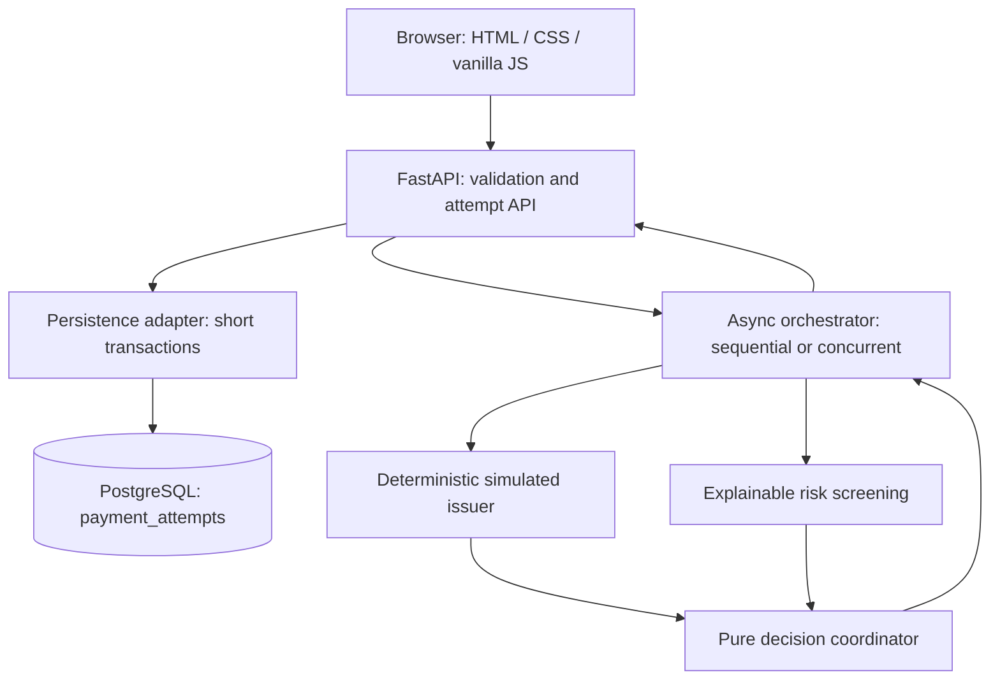

# AsaanPay architecture

## Scope and document status

AsaanPay is an educational synthetic payment-orchestration simulator for a DevOps software architecture assignment. Its purpose is to demonstrate how asynchronous orchestration changes latency while preserving deterministic decisions.

Milestone 1 implements only the FastAPI entry point, lifespan-managed asyncpg pool, database health endpoint, initial schema, Docker Compose setup, and minimal verification tests. Milestone 2 adds deterministic issuer/risk engines, immutable result contracts, and a pure decision coordinator. Milestone 3 implements both execution modes, artificial waits, branch deadlines, and timing traces. Milestone 4 adds persistent checkout endpoints, atomic idempotency ownership, and single-instance startup recovery. Milestone 5 adds the responsive browser checkout, retry-safe API client, actual timing visualization, and an explicit two-mode comparison. Milestone 6 adds controlled, paired endpoint benchmarks with retained measurements and reliability validation. Implementation stops at Milestone 6; presentation work remains deferred.

The fixed scope is one FastAPI application, PostgreSQL, HTML/CSS/vanilla JavaScript, Docker Compose, two independent async simulator operations, and a pure decision coordinator. Both sequential and concurrent modes must implement the same decision semantics.

## Architecture and rationale

The browser calls the FastAPI application, which validates a request, reserves an attempt in PostgreSQL, executes the simulator operations, combines their results, and persists the outcome. The same application serves the static browser assets. Docker Compose will run one application service and one PostgreSQL service.



This is a logical component diagram, not a collection of services. A single process is sufficient to demonstrate `asyncio` scheduling without introducing networked services, a queue, or a worker system. The two branches use only immutable synthetic request data; neither reads the other branch's result or modifies shared state. The orchestrator owns scheduling, timeouts, cancellation, and timing. The coordinator owns only the decision matrix.

V1 uses exactly one application process/instance and one worker. PostgreSQL provides durable attempts and an atomic unique-key constraint, rather than relying on an in-memory duplicate check. Restricting database access to short transactions keeps artificial waits from occupying an open transaction or a borrowed database connection.

Sequential mode awaits issuer authorization and then risk screening. Concurrent mode schedules both branches before awaiting their results. Both branches run even if the issuer returns DECLINED: a business decline is a valid branch result, and a later technical risk failure must still make the attempt ERROR. Ordinary technical failures are captured as results; both branches are awaited before coordination, as described below.

Concurrency here means overlapping async branch lifetimes on the event loop. It does not imply parallel CPU execution or establish anything about real payment-system performance.

## Component contracts

| Component | Inputs | Outputs and obligations |
| --- | --- | --- |
| Request/API boundary | Idempotency key and validated request body | Validate and normalize before creating an attempt; reject unknown fields; retrieve or reserve the durable attempt; serialize the stored result. |
| Persistence adapter | Normalized request, immutable fingerprint, state/result updates | Atomically reserve a unique key, compare duplicates, enforce allowed state changes, and persist trace/outcome with short transactions. Never start simulator work. |
| Simulated issuer | Synthetic card_preset; artificial delay applied by orchestration wrapper | Return the APPROVED or DECLINED enum. No database calls, randomness, external requests, or dependence on mode. May raise a technical failure. |
| Risk screening | Decimal amount_pkr and billing_country; artificial delay applied by wrapper | Return immutable status, ordered HIGH_VALUE/CROSS_BORDER reason codes, and readable evidence including triggered values and threshold/country comparison. No dependency on issuer output, database, current time, randomness, or mode. May raise a technical failure. |
| Async orchestrator | Synthetic inputs, mode, workload profile, branch timeout policy | Schedule/await both branches; collect results and monotonic timings; translate technical exceptions/timeouts into failure markers for the coordinator; clean up started tasks. |
| Pure coordinator | Issuer and risk results, or explicit technical-failure markers | Return SUCCEEDED, DECLINED, VERIFICATION_REQUIRED, or ERROR according to the complete matrix below. No I/O, time access, state mutation, or knowledge of delays/mode. |
| Browser UI | Attempt API responses | Submit synthetic requests, show decisions and explanations, poll nonterminal attempts, and label every configured delay as artificial. |
| Benchmark runner (Milestone 6) | Fixed corpus, modes, profiles, fresh keys | Measure client API latency, retain server timing traces, check decisions, calculate overlap and summary statistics, and preserve raw results. |

The coordinator treats missing/invalid results as ERROR and gives explicit technical failures precedence over business results. The orchestrator captures exceptions/timeouts as typed markers and retains branch traces; the coordinator does not execute operations or catch runtime exceptions itself.

### Implemented fictional sandbox rules (Milestone 2)

Merchant country is fixed to `PK`. `card_preset` accepts `approved` and `declined`, mapping deterministically to APPROVED and DECLINED. Risk is VERIFY if `amount_pkr >= 50000` **or** `billing_country != "PK"`; otherwise CLEAR. Explanations must identify every triggered rule, observed value, and threshold/country comparison. These are fictional sandbox rules, not financial or fraud advice.

The storage choice for amounts is `NUMERIC(14,2)`: positive PKR amounts with at most two fractional digits, up to 999999999999.99. Future API validation must reject excess precision rather than let PostgreSQL round it. Billing country is normalized to two uppercase ASCII letters; V1 does not need a country registry. Mode, delay, IDs, and keys never affect branch results. Boundary checks should include 49999.99, 50000, and 50000.01, plus foreign-country cases below the threshold and cases triggering both rules.

Technical fault fixtures belong in the future validation harness; no public fault-injection API is planned.

## State machine and decision matrix

| Current state | Allowed next state | Meaning |
| --- | --- | --- |
| CREATED | PROCESSING | A durable attempt exists and its original creator is starting orchestration. |
| CREATED | ERROR | A technical failure prevents processing, or startup recovery identifies an interrupted attempt. |
| PROCESSING | SUCCEEDED | Issuer APPROVED and risk CLEAR. |
| PROCESSING | VERIFICATION_REQUIRED | Issuer APPROVED and risk VERIFY. |
| PROCESSING | DECLINED | Issuer DECLINED and a valid result from risk. |
| PROCESSING | ERROR | Any technical failure, timeout, or interrupted processing. |
| Any terminal state | None | Terminal decisions, errors, and traces are retained; duplicates do not transition them. |

SUCCEEDED, DECLINED, VERIFICATION_REQUIRED, and ERROR are terminal. CREATED and PROCESSING are nonterminal. There is no transition from ERROR back to PROCESSING and no verification-completion flow. A deliberately new experiment requires a new idempotency key.

| Issuer | Risk | State | Stable decision reason |
| --- | --- | --- | --- |
| APPROVED | CLEAR | SUCCEEDED | `APPROVED_AND_CLEAR` |
| APPROVED | VERIFY | VERIFICATION_REQUIRED | `RISK_REQUIRES_VERIFICATION` |
| DECLINED | CLEAR | DECLINED | `ISSUER_DECLINED` |
| DECLINED | VERIFY | DECLINED | `ISSUER_DECLINED` |
| Technical failure or timeout in either branch or orchestration | Any/absent | ERROR | Typed technical error; no business decision |

A technical error takes precedence even if the other branch has already returned DECLINED. The pure coordinator now implements all five rows using explicit BranchFailure markers for technical errors/timeouts, as required by Milestone 2. The Milestone 3 orchestration boundary translates runtime exceptions/timeouts into those markers.

Equivalence means matching terminal state, business decision reason, and deterministic branch results/explanations for the same business inputs and workload/fault scenario. IDs, execution mode, timestamps, and timings naturally differ. Failure traces may contain different partial work because a sequential branch may not have started when a failure occurs. Equivalent deterministic fault cases must still end in ERROR in both modes.

## Implemented persistence and idempotency contract

Use one `payment_attempts` table. No separate issuer, risk, event-log, or benchmark tables are needed for the baseline.

| Field(s) | Purpose and constraints |
| --- | --- |
| `id` | Server-generated UUID primary key. |
| `idempotency_key` | Required, unique, case-sensitive string; length 1–128 printable ASCII characters without whitespace. Immutable. |
| `request_fingerprint` | Immutable SHA-256 digest of the canonical normalized request. |
| `amount_pkr`, `card_preset`, `billing_country` | Normalized synthetic inputs. Merchant country is fixed in application policy, not a request field. |
| `execution_mode`, `workload_profile` | Execution controls included in the fingerprint. |
| `state` | One of the six states. |
| `rule_set_version` | Synthetic rule version, initially `sandbox_v1`. |
| `issuer_result`, `risk_result` | Nullable constrained business-result strings. Failed branches have null business results; technical status stays in the unchanged orchestration trace. |
| `decision`, `decision_reason` | Nullable business outcome and explanation. Decision must agree with state when present; ERROR has no business decision. |
| `error_reason` | Nullable technical failure/interruption reason; required for ERROR. |
| `timing_trace` | Nullable JSONB object preserving the Milestone 3 delays, intervals, and technical completion statuses exactly. |
| `created_at`, `processing_started_at`, `finished_at` | Timezone-aware audit timestamps; start/finish nullable until reached. |

`db/schema.sql` is the only schema source. It uses ordinary NOT NULL, CHECK, primary-key, and unique constraints; no ORM, Alembic, triggers, or migration framework. The storage adapter enforces request immutability and legal state transitions by updating only mutable columns with state guards. The initial schema does not prevent direct SQL administrators from changing request fields. This keeps Milestone 1 small without claiming database-enforced immutability that is not implemented.

### Canonical request and duplicate behavior

Normalize and validate before hashing: apply documented defaults, preserve the allowed string values, represent the validated decimal amount as a fixed two-decimal string (for example `"100.00"`), uppercase the billing country, sort JSON object keys, and encode compact JSON as UTF-8. Equivalent object key ordering and omission of a default must produce the same normalized request. Reject unknown fields instead of silently ignoring them. Store the normalized fields so payload equality can be checked alongside the digest.

The fingerprint covers `amount_pkr`, `card_preset`, `billing_country`, `execution_mode`, and `workload_profile`. It excludes the idempotency key, generated IDs, timestamps, and measured timing. Changing mode or delay profile under an existing key therefore returns 409; benchmarking the other mode requires a fresh key. This scope is fixed because execution controls are part of the requested experiment.

1. In a short transaction, attempt to insert a CREATED row under the unique key. Only the successful insert owns permission to process that attempt. A preliminary read alone is not sufficient to reserve a key.
2. On a uniqueness conflict, read the committed existing row and compare its normalized request and fingerprint. A mismatch returns 409 regardless of the existing state. A match returns the current resource: nonterminal returns 202; terminal returns 200. Neither path launches operations or claims an existing CREATED row.
3. The original creator performs a short guarded CREATED-to-PROCESSING update and commits it before scheduling any simulator work. Release the database connection before awaiting the branches.
4. Execute the chosen mode with no open database transaction or held database connection during artificial waits.
5. Persist branch results, terminal state, error/reason, and trace together in a short final transaction guarded by PROCESSING. Return a terminal resource only after durable finalization.

Concurrent same-key submissions are resolved by PostgreSQL's unique constraint. The losing request may wait briefly for the inserting transaction to commit, never for an artificial simulator delay. Same-key retries of an ERROR outcome also return the stored ERROR; they do not run again. No expiry or automatic deletion of idempotency keys is proposed for the assignment.

This is duplicate suppression with one original processing owner, not a promise that every accepted attempt completes across crashes. If an insertion/commit outcome is uncertain, do not launch operations speculatively; return a storage error and reconcile through the same key. The recovery policy below prevents interrupted attempts from being rerun.

## Implemented checkout API contract (Milestone 4)

Use a small resource API under `/api/checkouts`. The first POST processes inline and normally waits for a durable terminal outcome. Duplicate callers can receive a nonterminal snapshot and use GET to poll. No detached job runner is implied by returning 202 for a duplicate.

### Create or retrieve by idempotency key

`POST /api/checkouts`, with `Content-Type: application/json` and a required `Idempotency-Key` header.

| Request field | Contract |
| --- | --- |
| `amount_pkr` | Required positive decimal PKR amount as a JSON number or decimal string, with at most two significant fractional digits within NUMERIC(14,2) bounds; reject booleans/nonfinite values. JSON fractional tokens are parsed directly as Decimal; trailing zeros are accepted. |
| `billing_country` | Required two-letter country code, normalized to uppercase. Merchant country remains PK. |
| `card_preset` | Required: `approved` or `declined`. |
| `execution_mode` | Required: `sequential` or `concurrent`. |
| `workload_profile` | Optional; defaults to `lightweight`. Allowed profiles are listed in the benchmark section. |

Illustrative JSON request, not application code:

```json
{
  "amount_pkr": 10000,
  "billing_country": "PK",
  "card_preset": "approved",
  "execution_mode": "concurrent",
  "workload_profile": "balanced"
}
```

POST and GET return this stable resource structure:

| Response field | Meaning |
| --- | --- |
| `id`, `state`, `terminal` | Attempt identity, current state, and whether it has a final outcome. |
| `request` | Stored normalized inputs/controls; amount_pkr is a fixed two-decimal string and country is uppercase. |
| `rule_set_version` | Rules used for this attempt. |
| `issuer_result`, `risk_result` | Business-result strings or null. Technical branch status remains in the timing trace; full engine explanation objects are not separately persisted by this schema. |
| `decision`, `decision_reason`, `error_reason` | Business state and readable decision_reason, or nonempty sanitized error_reason for ERROR with decision/decision_reason null. No stack traces. |
| `timing_trace` | Configured artificial delay values, actual branch intervals/statuses, and orchestration duration; null until a trace is available. |
| `created_at`, `processing_started_at`, `finished_at` | UTC timestamps. |

An active duplicate may expose only a state and null result/trace fields; live per-branch updates are not required. Response names are stable for V1. State remains authoritative; the optional business decision must equal the business terminal state when populated.

| HTTP status | Meaning |
| --- | --- |
| 201 | The original POST created and durably finalized an attempt, including a terminal ERROR. The body always determines the simulation outcome. |
| 200 | POST found a matching terminal attempt, or GET returned an existing attempt. |
| 202 | POST found a matching CREATED/PROCESSING attempt; no new processing was started. |
| 422 | Invalid inputs, including missing/malformed Idempotency-Key, malformed JSON, invalid fields, types, or unsupported values. No attempt is created. |
| 409 | Existing key has a different normalized payload. Existing attempt is unchanged. |
| 404 | GET could not find the requested attempt ID. |
| 503 | Storage is unavailable or durable reservation/finalization cannot be confirmed. No terminal result is promised. |
| 500 | Unexpected failure of the API boundary that cannot be returned as a durably stored attempt resource. |

POST responses containing an attempt include a `Location` header for its GET resource. A 202 response includes `Retry-After: 1`. Duplicate responses return the stored attempt's identity and outcome, although the HTTP status differs from the original 201.

Non-resource API errors use FastAPI's `detail` envelope (a sanitized message; malformed UUID validation may use a validation-detail list). A 409 response must not disclose a different caller's submitted payload. A failed HTTP response does not by itself establish whether a reservation or final commit occurred; callers reconcile using the same key.

Treating a durably recorded simulator ERROR as 201 separates successful resource creation from simulation outcome. This resolved status-code policy means clients and benchmarks must inspect `state`, not interpret all 2xx responses as SUCCEEDED.

### Read an attempt

`GET /api/checkouts/{id}` returns the current stored resource with 200, or 404. It never schedules, retries, resumes, or alters processing. No PATCH, DELETE, verification-completion, refund, or real-payment endpoint is proposed.

## Failure, timeout, and recovery policy

| Condition | Required outcome / proposed handling |
| --- | --- |
| Issuer business decline | Continue to obtain a valid risk result; final state DECLINED unless a technical failure occurs. |
| Risk requests verification | VERIFICATION_REQUIRED only if issuer is APPROVED; otherwise DECLINED. |
| Branch exception or invalid result | ERROR with a sanitized code and component. Retain any completed peer result for explanation, without applying the decision matrix. |
| Branch timeout | ERROR with `BRANCH_TIMEOUT` and branch identity; record the actual elapsed time and configured deadline. |
| Coordinator or orchestration exception | Propagate to the request boundary, which persists ERROR when storage is available; never substitute a business outcome. |
| Cancellation after reservation | Stop and await started branch tasks; best effort persist ERROR with `REQUEST_CANCELLED`. If persistence cannot complete, use interrupted-attempt recovery. |
| Database failure before a confirmed reservation | Return 503; run no simulator operations. |
| Database failure after reservation/finalization attempt | Return 503 if durability cannot be established; do not claim a terminal decision or start a second simulation. Re-read the row when storage recovers before any state repair. |
| Application process loss | The row may remain nonterminal until recovery; recover it to ERROR without executing the branches again. |

The per-branch timeout is 2000 ms (2 seconds), measured from that branch's actual start. A sequential risk branch's budget does not include time spent waiting for the issuer branch. Configured artificial delays are below this budget. No separate, shorter orchestration deadline is proposed; any future request/proxy deadline must allow the sequential path plus persistence and cleanup overhead.

Milestone 3 resolves the earlier proposed fail-fast policy by joining both branches after ordinary technical failures in both modes. Each wrapper converts Exception instances and timeouts into typed results, so TaskGroup observes normal completion and waits for its peer. This retains both branch outcomes and consistent deterministic error priority at the cost of waiting for the peer's remaining timeout budget. Two failures retain both traces, with issuer-first primary error priority in the unchanged coordinator.

Genuine asyncio.CancelledError is re-raised, never converted to ERROR. Parent cancellation causes TaskGroup to cancel and await its children; sequential execution propagates cancellation through the currently awaited wrapper. A child that independently cancels is re-raised when its task result is retrieved after the group joins. No final result/trace is returned for a cancelled orchestration. Internal unexpected orchestration/coordinator bugs propagate to the API boundary rather than being mislabeled as a branch failure. Injected operations must cooperate with cancellation; asyncio deadlines cannot forcibly preempt blocking CPU work or a coroutine that suppresses cancellation.

A client disconnect is not a request to run the payment again. If the request task remains active, it may finish normally; if it is cancelled, apply cancellation cleanup and best effort error persistence. A subsequent same-key request retrieves whichever durable state exists. Do not promise disconnect survival without a worker system.

Implemented single-instance recovery policy: before accepting traffic on startup, mark leftover CREATED/PROCESSING rows ERROR with `PROCESS_INTERRUPTED` in a short transaction. Preserve available evidence and mark missing timing as incomplete; do not invent durations after a crash. Do not change already terminal rows. If PostgreSQL is unavailable, startup recovery cannot complete and the application must not begin serving attempts. This policy requires there to be no other live application process working on those rows. This simple recovery policy is NOT safe for multiple independent API instances. Multiple workers, overlapping deployments, and lease-based recovery require a new design. Milestone 4 runs this update after pool creation and before serving traffic; a recovery failure stops startup and closes the pool.

An infrastructure failure can prevent an ERROR from being written immediately. If the process survives a failed final write, the attempt may remain nonterminal until an exclusive application restart performs recovery; live background repair is not proposed. A commit that actually succeeded must be preserved when the row is read again. Until storage and recovery are available, an existing nonterminal row is evidence of an interrupted/uncertain attempt, not permission to rerun it. There are no automatic branch retries, and API callers must reuse the same key when reconciling an uncertain response.

## Timing trace and controlled benchmark

### Artificial workload profiles

| Profile | Issuer artificial delay | Risk artificial delay | Purpose |
| --- | --- | --- | --- |
| `lightweight` | 0 ms | 0 ms | Show orchestration and scheduling overhead with no intentional wait. |
| `balanced` | 250 ms | 250 ms | Show overlap of balanced synthetic waits. |
| `asymmetric` | 100 ms | 400 ms | Show the effect of one longer synthetic wait. |

Use asynchronous artificial waits; blocking sleep would invalidate the intended experiment. Profiles describe configured waits, not measured latency. All three profiles are implemented in the callable orchestrator. Label profile values in documentation, the UI, and benchmark output as **artificial simulated workload delays**.

Ignoring overhead, the modeled wait contribution for the balanced profile is about 500 ms sequential versus 250 ms concurrent; for the asymmetric profile it is about 500 ms versus 400 ms. These are explanatory estimates, not results or latency guarantees. The 0/0 profile may show little benefit or greater overhead for concurrency.

### Measurements and definitions

Use a monotonic clock for all elapsed measurements within a process. Use UTC wall-clock timestamps only for audit display. Do not subtract server and client timestamps from different clock domains.

| Metric | Measurement boundary |
| --- | --- |
| Orchestration latency | Immediately before scheduling/executing the first branch to after both valid results and coordination, or after error/cancellation cleanup. Excludes reservation and final persistence. |
| Branch interval | Actual branch start through completion, failure, timeout, or cancellation. Record offsets relative to orchestration start and a completion status. Unstarted branches have null offsets. |
| API latency | Client monotonic time immediately before sending the POST through receipt of the complete response body. Includes transport, validation, database work, orchestration, and response handling. |
| Actual branch overlap | For two completed branch intervals: `max(0, min(issuer_end, risk_end) - max(issuer_start, risk_start))`, in milliseconds. |
| Decision correctness | Compare each terminal decision against the explicit matrix oracle and compare each paired sequential/concurrent outcome and explanation. |

Each persisted trace must identify the artificial profile and configured delays separately from actual elapsed times. Record branch completion status, the timeout budget, orchestration duration, and whether the trace is complete. If a branch never started, overlap is unavailable rather than a fabricated zero. The benchmark's ordinary overlap summaries use complete, successful branch executions; failed/cancelled traces are diagnostic evidence reported separately. A business DECLINED or VERIFICATION_REQUIRED is still a completed, valid branch execution.

Interval overlap demonstrates simultaneous outstanding branch work, not simultaneous CPU execution or real network I/O. Compute it from measured intervals, never from the configured delays or the selected mode. Normal sequential runs should have zero overlap; concurrent 250/250 runs should show overlap, while 0/0 overlap may be negligible.

### Implemented repeatable procedure (Milestone 6)

1. Use the running local endpoint with one API worker and a synchronous client. Record the client environment, source hashes/revision, rules, timeout, profiles, and run configuration. Supply recorded server/container metadata with `--environment-json` when available.
2. Cycle a fixed ten-case corpus: both issuer presets crossed with below/at/above-threshold domestic amounts, a low foreign amount, and both risk triggers. Both modes receive identical paired business inputs. Expected outcomes are specified independently of the application coordinator.
3. Run **5 warm-ups per mode/profile**, then **50 measured attempts per mode/profile**: **30 warm-ups and 300 measured attempts**. Counts are CLI-configurable. At the default size each case appears five times per mode/profile. Warm-ups never enter measured statistics.
4. Rotate profile order by round and counterbalance which mode runs first in adjacent pairs. Each mode is first 25 times per profile at the default size. Use fresh unique prefixed keys for every request. One outstanding request measures within-checkout concurrency, not throughput.
5. Retain raw CSV/JSONL including request identity, case/pair/order, response body, status, decision, HTTP elapsed time, branch intervals/durations/overlap, and server `orchestration_ms`. Never infer timings from configured waits.
6. Validate expected decisions, pair equivalence (including explanation), fresh 201 resources/unique IDs, echoed inputs, and actual trace arithmetic. Sequential overlap must be zero; delayed concurrent profiles must overlap. The numeric tolerance is 0.000001 ms (1 ns), solely for arithmetic precision.
7. Preserve every failed or invalid submission, count it in error/correctness denominators, flag the experiment FAIL, and exit nonzero. Stop if execution is uncertain (such as transport failure or nonterminal response) so another checkout cannot overlap outstanding server work. No retries or polling enter timing samples.
8. Summarize valid measured samples by mode/profile: mean, median, nearest-rank P95 (`ceil(0.95 × n)`, one-based), min, max, and sample standard deviation (n−1) for HTTP, orchestration, issuer, risk, and overlap. Empty metrics are unavailable, not zero. Include all-attempt HTTP diagnostic statistics and complete failure details separately.
9. Report measured decision correctness, mode-pair agreement, errors/rates, case/order counts, and median concurrent reductions for complete valid delayed workloads. Do not claim meaningful speed improvement for lightweight timing differences. Label synthetic expectations separately from actual measurements.
10. Preserve artifacts under `benchmarks/results/`; never clean up database rows automatically. [Benchmark guide](../benchmarks/README.md) documents clean-start reproduction, the exact measurement policy, and optional deletion using a run's exact key manifest. [Full report](../benchmarks/results/milestone6-full/report.md) and [verification](../benchmarks/verification.md) contain the completed evidence.

Deterministic fault/cancellation checks are separate from normal latency samples. Verify that technical failures and branch timeouts produce ERROR in both modes, that valid declines still await risk, and that no peer task is left running. Real scheduling or infrastructure may cause a timeout in only one mode; report this as a failed equivalence sample/infrastructure limitation, not an acceptable decision difference.

### Validation evidence

Regression checks cover the complete matrix, threshold boundaries, equality of both modes, technical failures/timeouts, cancellation cleanup, startup interruption recovery, and immutable terminal results. Idempotency checks must include simultaneous same-key requests, same-key replays during and after processing, a changed-payload 409 in both nonterminal and terminal states, default normalization, and replay of ERROR without restarting. Persistence checks must demonstrate that no database transaction/borrowed connection spans an artificial wait and that final state and trace are committed together.

Milestone 1 tests startup, health behavior, pool cleanup, and opt-in database/schema checks. Milestone 2 tests the full decision matrix, threshold/country combinations, multiple reasons, invalid inputs, typed failures/timeouts, deterministic repeated results, and immutable outputs. Milestone 3 also tests mode equivalence, actual overlap/critical path, per-branch deadlines, cancellation, and absence of orphaned tasks. Milestone 6 preserves actual endpoint measurements and distinguishes modeled wait estimates from observed results.

## Constraints and deliberate exclusions

- One application service/process and one PostgreSQL service; the browser uses HTML/CSS/vanilla JS served by the application.
- No real payment processing, settlement, balances, cardholder data, secrets from payment providers, issuer integrations, or production fraud claims.
- No microservices, Redis, message broker, job worker, distributed tracing platform, or extra datastore.
- No authentication platform, multi-tenant accounts, refunds, reconciliation ledger, manual verification workflow, or production availability claim.
- No arbitrary public delay configuration or public fault-injection controls in the proposed baseline; fixed profiles keep the experiment small and reproducible.
- No transaction or database connection held across simulator waits; no blocking simulator waits; no retries that rerun an existing idempotency key.
- Milestone 1 uses asyncpg directly and PostgreSQL 17, with Python dependencies pinned in requirements.txt. Milestone 5 adds the UI; Milestone 6 adds a standard-library benchmark runner. No new dependencies or schema changes were needed.

## Current file tree

```text
asaanpay/
├── README.md
├── docs/architecture.md
├── app/
│   ├── __init__.py
│   ├── main.py                 # lifespan pool, recovery, health, route registration
│   ├── checkouts.py            # validation, canonicalization, POST/GET resources
│   ├── storage.py              # atomic ownership and guarded durable updates
│   ├── contracts.py            # immutable enums/dataclasses
│   ├── simulators.py           # deterministic async engines, no waits
│   ├── coordinator.py          # pure decision function
│   ├── orchestration.py        # sequential / TaskGroup, waits, deadlines, trace
│   └── static/
│       ├── index.html          # responsive semantic checkout page
│       ├── styles.css          # navy/teal desktop and mobile layout
│       ├── core.js             # client lifecycle and pure trace calculations
│       └── app.js              # safe DOM rendering and user interactions
├── scripts/benchmark.py       # paired endpoint benchmark and trace validation
├── benchmarks/
│   ├── README.md               # reproduction, definitions, retention
│   ├── verification.md         # regression outcomes and experiment audit
│   └── results/                # actual smoke/full CSV, JSONL, JSON, reports
├── db/schema.sql
├── tests/
│   ├── test_benchmark.py       # statistics, ordering, trace/failure accounting
│   ├── test_health.py          # mocked startup/health/recovery checks
│   ├── test_checkouts.py       # validation and live PostgreSQL API/race checks
│   ├── test_database.py        # opt-in PostgreSQL checks, rolled-back fixtures
│   ├── test_decisions.py       # engine rules, matrix, and technical failures
│   ├── test_orchestration.py   # ordering, real overlap, deadlines, cancellation
│   ├── test_static.py          # static routes coexist with API routes
│   ├── run_frontend.py         # optional installed-Chrome test runner
│   ├── frontend.html          # isolated browser test harness
│   ├── frontend_tests.js      # client tests and live browser smoke
│   └── fixtures/timing_traces.json # captured actual trace evidence
├── requirements.txt
├── Dockerfile
├── compose.yaml
├── .env.example
├── .gitignore
└── .dockerignore
```

The frontend is buildless and served by FastAPI. The Milestone 6 benchmark is a standalone script, with no history dashboard or load-testing infrastructure.

## Milestone 1 lifecycle and deployment

The FastAPI lifespan creates one asyncpg pool (one initial connection, maximum five), then closes it on shutdown with bounded cleanup. Failed initial connectivity/configuration causes a clear startup failure. Each GET `/api/health` performs `SELECT 1`, bounded to three seconds including pool acquisition. It returns 200 with `{"status":"ok","database":"connected"}`, or 503 with `{"status":"unhealthy","database":"unavailable"}`. Health probes test connectivity, not table readiness; the opt-in database test checks the schema separately.

Compose runs exactly one Uvicorn worker and one PostgreSQL service. The API waits for PostgreSQL's health check; it also has its own HTTP health check. Database data lives in a named volume. `db/schema.sql` is mounted read-only into `/docker-entrypoint-initdb.d/001-schema.sql`. Initialization scripts run only for an empty PostgreSQL data directory: restarting or rebuilding does not reapply SQL to an existing volume. Reset is explicitly destructive and is documented separately in README; no volume is automatically deleted.

This follows [FastAPI lifespan guidance](https://fastapi.tiangolo.com/advanced/events/), the [asyncpg pool API](https://magicstack.github.io/asyncpg/current/api/index.html#connection-pools), and the [official PostgreSQL image initialization contract](https://hub.docker.com/_/postgres).

## Seven-day milestones

Days are relative project days. Milestone 1 covers infrastructure and Milestone 2 covers engines/coordinator. Milestone 3 adds orchestration and Milestone 4 adds persistent checkout resources. Milestone 5 adds the checkout UI and measured timelines. Day 6 is implemented and measured; day 7 remains planning only.

| Day | Planned work | Reviewable completion evidence |
| --- | --- | --- |
| 1 | Resolve architecture; app, pool, health endpoint, initial schema, Compose, and verification. | Milestone 1 startup and connectivity evidence; no checkout behavior. |
| 2 | Deterministic issuer/risk engines, explicit contracts, pure coordinator. | Full matrix, threshold/country rules, multiple reasons, deterministic results, and typed failure/timeout cases pass. |
| 3 | Sequential/concurrent orchestration, artificial waits, timeouts, and timing. | Both modes agree on decisions; measured overlap and task cleanup verified; business declines do not skip risk. |
| 4 | Persistence/idempotency, create/read API, and startup recovery behavior. | API contract checks and deterministic failure cases produce the specified durable outcomes without restarting duplicates. |
| 5 | Small browser UI and Docker Compose environment. | One app and PostgreSQL run together; UI shows explanations, states, and clearly labeled artificial delays. |
| 6 | Paired benchmarks and correctness verification. | Raw observations, environment notes, median/P95 summaries, overlap measurements, error counts, and pair comparisons available. |
| 7 | Review results and limitations; finish assignment demonstration and usage documentation. | Repeatable demonstration of both modes, all business outcomes, idempotency, and a technical failure; conclusions supported by measured data. |

## Resolved decisions and tradeoffs

| Decision | Resolution and tradeoff |
| --- | --- |
| API lifecycle | Inline POST `/api/checkouts`; 201 after durable terminal outcome, including ERROR. Duplicate identical payload: 200 terminal or 202 unfinished. Different payload: 409. GET by ID: 200 or 404. Invalid input: 422. No worker system, so interruption recovery is needed. |
| Request identity | SHA-256 over canonical normalized amount_pkr, card_preset, billing_country, execution_mode, workload_profile. Exclude generated IDs/timestamps. Changing mode/profile requires a new key. |
| Rules | Merchant PK; approved/declined card presets; VERIFY for amount >= 50000 or foreign billing country. Explainable fictional sandbox behavior, never real authorization. |
| Timeouts/profiles | Two seconds per branch from its own start; lightweight 0/0, balanced 250/250, asymmetric 100/400 ms. All waits artificial. A common shorter global deadline would unfairly penalize sequential mode. |
| Recovery | One API instance/process only. After connectivity at startup, unfinished rows may become ERROR with interruption reason, never rerun. Unsafe with multiple independent instances. Recovery runs before serving requests in Milestone 4. |
| Storage | asyncpg, one db/schema.sql, no ORM/Alembic. Simple constraints now; request immutability/state-transition guards in the storage adapter. Existing volumes require deliberate schema management. |
| Amount representation | NUMERIC(14,2) preserves decimal PKR. Checkout validation rejects excess precision; canonical hashing uses a two-decimal string, avoiding binary-float identity differences. |

Milestone 6 uses 5 warm-ups and 50 measured attempts per mode/profile by default, with both CSV and JSONL raw evidence. CLI arguments override counts. All three profiles are measured without altering their delays or trace semantics.

## Milestone 2 callable contracts

`app/contracts.py` defines IssuerResult, RiskStatus, RiskReason, BranchFailure, and DecisionState enums, plus frozen RiskResult and Decision dataclasses. A business DECLINED is a successful issuer computation, distinct from a technical failure.

`await simulate_issuer(card_preset: str) -> IssuerResult` and `await screen_risk(amount_pkr: Decimal, billing_country: str) -> RiskResult` execute immediately without I/O or artificial waits. The latter requires an exact finite positive Decimal within NUMERIC(14,2) bounds, rejects nonzero precision beyond two fractional digits, and normalizes two ASCII country letters to uppercase. Extra trailing decimal zeros are harmless. Unsupported presets or invalid countries/amounts raise validation errors; they never silently approve/clear. No real card fields are accepted.

`coordinate_decision(issuer, risk) -> Decision` is synchronous and has no mode, timing, database, or HTTP inputs. It accepts a typed issuer/risk result or BranchFailure.TECHNICAL_ERROR / BranchFailure.TIMEOUT in either position. A missing result may be represented by None. Explicit failures take precedence; two failures use stable issuer-first priority. Missing/invalid results without a failure marker produce ERROR with INVALID_BRANCH_RESULT. The returned state, reason_code, and readable reason are immutable. This does not add an ERROR value to the business-only database decision column: the persistence adapter stores state ERROR, decision NULL, and the technical reason in error_reason.

The coordinator never schedules tasks or turns a caught exception into a marker itself. Tests pass explicit failure markers to simulate technical outcomes. Milestone 3 implements runtime exception capture, cancellation propagation, two-second deadlines, and branch timing around the unchanged engines. No schema change is necessary.

## Milestone 3 callable interface and fork/join

`await orchestrate_payment(amount_pkr: Decimal, card_preset: str, billing_country: str, execution_mode: str, workload_profile: str = "lightweight") -> OrchestrationResult` has no HTTP or PostgreSQL dependencies. Invalid mode/profile/timeout configuration is rejected before starting work. Engine input validation errors are ordinary branch failures at this boundary; HTTP input validation rejects invalid requests before orchestration.

Sequential mode awaits the issuer wrapper then the risk wrapper. Concurrent mode creates both wrapper tasks in one `asyncio.TaskGroup`; exiting the group joins them, then the same pure `coordinate_decision` function combines the typed results. The branches use the same `simulate_issuer` and `screen_risk` implementations in both modes, with no mode argument passed into the business rules. Each wrapper awaits `asyncio.sleep` for its configured artificial delay before invoking its engine. Even the zero-delay profile yields cooperatively.

The keyword-only `branch_timeout_seconds` defaults to 2.0; `issuer_fn` and `risk_fn` default to the existing engines. Injection is an internal testing seam with the original engine signatures, not a public fault-injection feature. Ordinary Exception instances (including malformed return types) become BranchFailure.TECHNICAL_ERROR; TimeoutError becomes BranchFailure.TIMEOUT. Raw exception messages are omitted. External cancellation propagates. The timeout budget begins at each branch's actual execution and includes its artificial wait plus engine call, not time awaiting the previous sequential branch.

The result contains `issuer_result`, `risk_result`, the unchanged coordinator `outcome`, and `timing_trace`. Its `explanation` property is outcome.reason. Its `decision` property is None for ERROR, otherwise the business terminal state, preserving the database convention without itself writing any rows; the API owns persistence.

TaskGroup provides scoped task ownership and joining; cancellation behavior follows the [Python asyncio documentation](https://docs.python.org/3.13/library/asyncio-task.html#task-groups). Async waits release the event loop so another branch can progress. CPU-heavy synchronous code would occupy that event loop; this implementation neither parallelizes CPU work nor measures genuine payment-service performance.

## Milestone 3 timing trace

The trace is a plain JSON-compatible object. All elapsed values come from actual `time.perf_counter_ns()` observations with one orchestration start origin immediately before branch execution/scheduling. Durations and overlap are calculated using integer nanoseconds before conversion to milliseconds. No values are rounded internally; the UI rounds summary labels for display and exposes the original values in details. Trace construction/serialization, HTTP transport, and database work are excluded from orchestration duration.

| Field | Meaning |
| --- | --- |
| `execution_mode`, `workload_profile` | Selected mode and artificial workload name. |
| `artificial_delays` | Always true, including the zero-delay profile. |
| `measurement` | `synthetic_orchestration_not_payment_network_latency`. |
| `branch_timeout_ms` | Configured branch budget, default 2000. |
| `branches.issuer`, `branches.risk` | Objects with the branch fields below, always in issuer/risk order. |
| `branches.<name>.start_ms`, `.end_ms` | Measured offsets from orchestration start; start precedes artificial waiting, end follows completion or failure/timeout cleanup. |
| `branches.<name>.duration_ms` | Measured branch end minus start. |
| `branches.<name>.artificial_delay_ms` | Configured synthetic wait, separate from measured duration. |
| `branches.<name>.status` | `completed`, `technical_error`, or `timeout` on returned traces. A business DECLINED is completed. |
| `branches.<name>.error_type` | Exception class name or null, without raw exception messages. |
| `decision_ms` | Offset sampled immediately after the coordinator returns. |
| `orchestration_ms` | Elapsed time after join, coordination, and overlap calculation, before output trace construction. |
| `overlap_ms` | max(0, min(issuer_end, risk_end) - max(issuer_start, risk_start)), computed from raw measured intervals. |

Cancelled execution records cleanup internally but raises CancelledError instead of returning a fabricated outcome or partial trace. Ordinary failure/timeout traces retain both intervals; their overlap is diagnostic and must be excluded from later normal-performance summaries. No absolute monotonic timestamp is exposed as a wall-clock date.

## Milestone 4 persistence implementation and limits

`app/checkouts.py` parses raw JSON with Decimal fractional tokens before Pydantic validation; binary floating-point conversion is avoided. Unknown fields, unsupported presets/modes/profiles, invalid country codes, invalid amounts, malformed JSON, and missing/invalid/repeated Idempotency-Key headers return 422 before reservation. The response amount is always a decimal string. Canonical serialization uses sorted keys, compact separators, a fixed two-decimal amount string, uppercase country, and applied defaults. Fingerprints exclude IDs and timestamps.

`app/storage.py` uses only the existing pool and schema. Each pool query is a separate autocommitted statement with a five-second bound including acquisition. Reservation is INSERT ON CONFLICT DO NOTHING RETURNING; the losing path performs a separate SELECT with a fresh READ COMMITTED snapshot. It compares both fingerprint and normalized payload. Only the successful inserter executes CREATED -> PROCESSING -> orchestration -> terminal. There are no global locks, detached jobs, open database transactions, or borrowed connections during orchestration. One guarded terminal UPDATE stores state, branch business-result strings, decision/explanation, error_reason, and the unchanged JSONB trace atomically. ERROR branch-result columns are null where that branch failed; a completed peer's business result is retained.

The schema stores the final readable business explanation in decision_reason, or a sanitized code and explanation in error_reason. Full RiskResult explanation objects are not separately stored; preserving the existing schema and trace takes precedence over adding new explanation storage. The documented response exposes stored values only and never re-executes the engines on GET/replay.

Cancellation propagates after the orchestrator has joined its child tasks. The owning request then attempts a bounded, directly awaited ERROR update with REQUEST_CANCELLED; there is no shielded/detached cleanup task. Repeated cancellation, interruption during an uncertain insert/commit, or storage failure may leave a nonterminal row. Do not rerun it: recover on the next exclusive startup. Already terminal rows cannot be overwritten, including when a response/commit acknowledgement is lost. Startup recovery is unsafe for multiple independent API instances or overlapping deployments.

Live API integration tests use a dedicated one-connection pool, unique keys, and DELETE only their own records during teardown. A deterministic event gate holds the owner while five concurrent duplicates return 202; only one orchestration call occurs. The same test queries PostgreSQL from inside the injected orchestrator to prove the connection was released. Tests do not run global recovery against an already-running API. Milestone 1 startup tests verify recovery invocation and failure cleanup. Example POST/GET/replay curl commands are in [README](../README.md#submit-retrieve-and-replay).


## Milestone 5 browser interface

The only backend addition is `GET /` returning `app/static/index.html`, plus a `/static` mount resolved relative to `app/main.py`. Explicit static paths avoid shadowing `/api/health`, POST/GET checkouts, and API error responses. Existing lifespan, recovery, persistence, schema, orchestrator, and business contracts are unchanged. Docker's existing `COPY app` includes the assets; no deployment or dependency changes are necessary.

`index.html` and `styles.css` provide semantic labels, keyboard-operable radio/select controls, visible focus, a status live region, and a centered checkout above the optional Architecture Explorer. Milestone 5.3 keeps the Explorer initially collapsed under a compact pastel-green header, with a native button exposing aria-expanded/aria-controls and a direction-changing chevron. Only its click handler toggles the panel; hidden controls remain associated with the checkout form and retain their values. Result rendering and recovery never automatically expand it. The default demo is PKR 7500, approved preset, PK billing, concurrent mode, and balanced artificial workload. These are UI choices; the API's lightweight default is unchanged because the UI always submits its explicit profile. A small country selector offers PK and representative cross-border examples; the API continues accepting any valid two-letter ASCII code. Real card numbers/CVV/bank details are never requested.

`core.js` contains decimal-text input normalization, trace validation/layout, comparison arithmetic, and one small API client. `app.js` binds controls and renders returned data using `textContent`, not HTML interpolation. The API's state determines the result presentation: SUCCEEDED, DECLINED, VERIFICATION_REQUIRED, or technical ERROR. The UI shows branch business statuses, final explanation, ID, normalized inputs, mode, and profile. Individual risk reason codes are not currently persisted/exposed; when unavailable they are not inferred from inputs. The rules disclosure explains the fixed fictional policy separately from recorded evidence.

### Submission, uncertainty, and retry

Before a new POST, the client normalizes all five fields, generates `crypto.randomUUID()`, and retains that key/payload. Amounts remain exact decimal strings. An unresolved attempt, any known ID, and optional comparison baseline are saved in tab-scoped `sessionStorage`; reload offers an explicit retry without auto-submitting. Storage failure falls back to memory and displays a keep-this-tab-open notice. This is browser convenience, not a replacement for PostgreSQL idempotency or durable user accounts.

The customer checkout uses one persistent card. Its form is hidden during a real request, replaced by a plain processing status, then one terminal outcome and **Make Another Payment**. That action restores the existing form values without requesting or clearing execution evidence. Uncertainty shows the error and **Retry same attempt**, with neither editable inputs nor a new-payment action. Completed results focus their heading for keyboard users. No animation, fabricated progress, or minimum waiting period is added.

Only one request flow may run at a time. While busy or unresolved, input controls are locked. New submission is allowed only after a terminal resource or a definitive POST 409/422 rejection. HTTP 201, 200, and 202 describe creation, replay, and processing; they never imply a successful business outcome. 409 and 422 show actionable errors and require another explicit submit. Uncertain network/HTTP failures, unreadable responses, and 503 retain the original request for safe retry. A retry uses GET if the attempt ID is known, otherwise POST with the identical key and payload.

CREATED/PROCESSING resources are polled via GET every 1000 ms with a 30-second polling budget. Individual fetches have a 10-second abort deadline, shortened to the remaining polling budget when applicable. The initial request has a separate budget. A timeout stops the browser's wait, not a promise that the server stopped or rolled back; retain uncertainty and offer retry. No live branch progress is claimed. No automatic fresh-key retry, worker, or public failure injection is added.

### Timeline and comparison semantics

The browser consumes the unchanged Milestone 3 trace directly. It checks the measurement/artificial flags, known mode/profile/status, finite nonnegative values, ordered intervals and decision/total offsets, and consistency between recorded durations/overlap and intervals (allowing only floating-point conversion tolerance). Missing, incomplete, or inconsistent data displays an unavailable state.

The presentation layer chooses an axis maximum `A` from the largest valid recorded orchestration total in the displayed attempt(s), adding 5% headroom and rounding upward to a readable 1/2/2.5/5/10-based tick step. Bar start is `100 × start_ms / A` percent and width is `100 × (end_ms − start_ms) / A` percent. Both comparison plots use exactly the same zero-to-`A` scale, including after stacking on mobile. The underlying core trace calculations and recorded values are unchanged. A zero total produces zero-width bars; no minimum width, invented delay, mode-derived overlap, or animation is used. Summary labels use up to six significant digits, preserving small fractional values; expanded details and titles expose original numeric values. Recorded `duration_ms`, `orchestration_ms`, and `overlap_ms` are displayed without replacing them with configured delays. The trace is drawn only after an actual resource response; pending requests show an ordinary status indicator.

**Compare with other mode** explicitly starts one new attempt with the baseline's same normalized amount/preset/country/profile and only the mode switched. It uses a new key, since execution mode is part of request identity. A single **Execution Comparison** container replaces the single-run visualization and includes both attempts, their IDs, and the summary. Sequential and concurrent sections share a common scale, equal desktop plot widths, and aligned chart/metric rows, without individual outer cards. On narrow screens the sections stack inside the same container. The customer outcome remains the original payment, while both comparison outcomes appear in the Explorer. Muted-blue issuer (#6796BC) and muted-green risk (#599879) bars use measured widths; a resize observer places bold white duration text directly on the bar when it fits, otherwise dark text outside without stretching bars. Duration text has no separate background. Toggling the Explorer retains the existing comparison and its DOM nodes. Comparison controls cannot silently use edited form values. The percentage is `(sequential_total − concurrent_total) / sequential_total × 100`, only for matching business inputs/results, complete valid traces, and a positive sequential duration. Negative reductions are labeled higher concurrent latency. Technical errors or mismatched outcomes show comparison unavailable. This is two illustrative observations, not a benchmark or history dashboard; no median/P95 claims are made.

All views explicitly identify configured waits as artificial external I/O. Total orchestration excludes database/HTTP time and says nothing about actual payment-network latency or expensive fraud computation. Asyncio overlaps waits on one event loop; CPU parallelism is not implied.

### Milestone 5 verification

The original 47 backend tests remain intact. Three additional Python tests cover the page/assets, API route coexistence, and missing/traversal paths. Optional dependency-free browser tests use an existing Chrome/Chromium, a temporary isolated browser profile, and a short-lived localhost server proxying the existing sandbox API. Pure client tests cover state/status mapping, retries, key identity, polling bounds, comparison inputs, and layout math against captured real traces for all six profile/mode pairs. Browser smoke covers actual checkout/comparison requests, desktop/mobile layout, verification/decline rendering, safe uncertain retries, and fixture-driven technical ERROR/missing-trace/text-safety rendering. It creates synthetic attempts but does not delete existing data or run startup recovery. See README for commands and a manual demo. Milestone 6 adds eleven benchmark validation/accounting tests and waits for the iframe to finish loading in the browser harness; application/UI code remains unchanged. See the benchmark guide for actual results and regression outcomes.
