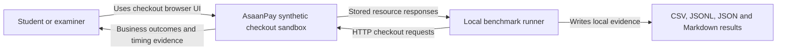
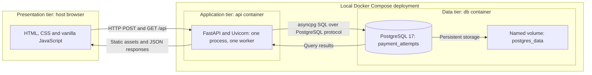
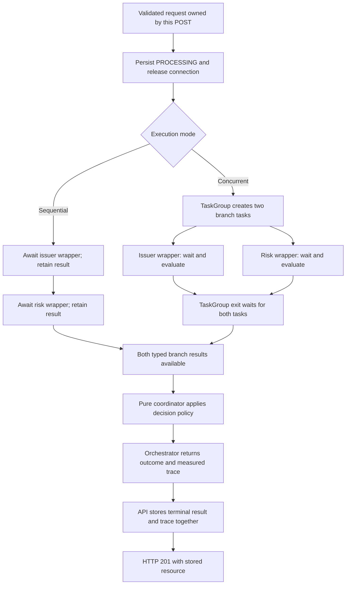

# AsaanPay: final implemented architecture

Milestone 7A presentation source material. This describes the implementation through Milestone 6; it introduces no application or deployment changes. AsaanPay is an educational synthetic payment-orchestration simulator. Its question is whether overlapping independent asynchronous waits reduces checkout-decision latency while preserving deterministic outcomes.

Use with the [seven-slide outline](presentation-outline.md), [live demo script](demo-script.md), [benchmark summary](benchmark-summary.md), and [professor Q&A](professor-qa.md). The detailed implementation history remains in [architecture.md](architecture.md).

## System context

The browser and benchmark runner are clients of the same application. The runner is an offline experiment tool, not a deployed service. The system does not contact an issuer, transfer money, or perform production fraud analysis. The configured waits simulate external I/O; the business engines themselves are deterministic local functions. Sources: [README](../README.md), [simulators](../app/simulators.py), [benchmark runner](../scripts/benchmark.py).

## Three-tier deployment

There are **three responsibility tiers and two containers**. The browser runs outside Compose; the API serves both its static assets and JSON routes. The API listens on container port 8000, published to a configurable localhost port; Milestone 6 used `http://localhost:18000`. PostgreSQL is reached through the Compose network and has no published host port. The browser never connects directly to PostgreSQL. Sources: [Compose](../compose.yaml), [Dockerfile](../Dockerfile), [application lifecycle](../app/main.py).

Startup creates an asyncpg pool (minimum one, maximum five connections), performs unfinished-attempt recovery, then serves requests. Compose waits for database health. `GET /api/health` checks connectivity with `SELECT 1`, not full schema correctness. `db/schema.sql` initializes an empty database data directory; it is not an automatic migration system.

## Components, communication and contracts

| Component | Input | Output and responsibility |
| --- | --- | --- |
| [Browser client](../app/static/core.js) and [DOM adapter](../app/static/app.js) | User's synthetic inputs and returned resources | Submit JSON with a fresh key, retain uncertain request identity, display decisions and actual stored traces; explicit comparison creates a second attempt. |
| [Checkout API](../app/checkouts.py) | `Idempotency-Key` plus amount, preset, billing country, mode and profile | Validate/normalize, establish ownership, call orchestration, persist, and return the stored resource. GET retrieves without executing. |
| [Storage adapter](../app/storage.py) | Normalized inputs, fingerprint, attempt ID and result | Short autocommitted SQL statements: reserve, mark processing, finalize, retrieve, or mark an unfinished attempt ERROR. |
| [Orchestrator](../app/orchestration.py) | Exact Decimal amount, preset, country, mode and profile | Own scheduling, artificial waits, deadlines, cleanup and timing; return typed branch results, coordinator outcome and `timing_trace`. |
| [Issuer and risk engines](../app/simulators.py) | Issuer: card preset. Risk: Decimal amount and country | Issuer returns APPROVED/DECLINED. Risk returns immutable status, reason codes and explanation. Neither reads the other branch or accesses the database. |
| [Coordinator](../app/coordinator.py) | Two typed results or failure markers | Synchronous, pure decision policy: state, stable reason code and readable explanation. No scheduling, HTTP or persistence. |

All component calls inside the API are Python calls/awaits, not network messages. Immutable result types in [contracts.py](../app/contracts.py) separate business values from `BranchFailure.TIMEOUT` and `BranchFailure.TECHNICAL_ERROR`.

The API accepts positive exact decimal PKR amounts with at most two significant fractional digits, up to `999999999999.99`; country is normalized to two uppercase ASCII letters. Presets are `approved`/`declined`, modes are `sequential`/`concurrent`, and profiles are `lightweight`/`balanced`/`asymmetric`. Extra fields are rejected. The API defaults to lightweight if the profile is omitted; the existing UI explicitly selects balanced by default.

A resource contains `id`, `state`, `terminal`, normalized `request`, `rule_set_version`, issuer/risk business results, `decision`, `decision_reason`, `error_reason`, `timing_trace`, and audit timestamps. Amounts are returned as decimal strings. `ERROR` has a null business decision. The full internal `RiskResult` reason-code list is **not** separately stored or exposed by the current API; the UI does not reconstruct missing evidence.

## Logical fork-and-join execution

This diagram covers ordinary completion, including captured branch failures; cancellation propagates instead of producing an orchestration result. The API separately handles persistence failures and unexpected orchestration exceptions.

**Sequential:** issuer finishes before risk starts. Both results remain available for coordination. An issuer decline or ordinary captured branch failure does not skip risk.

**Concurrent:** `asyncio.TaskGroup` schedules both wrappers. Each `asyncio.sleep` yields the event loop so the peer can progress. Exiting the group is the execution join; reading the task results and calling the coordinator performs the policy join. Ordinary branch exceptions/timeouts are converted to failure markers inside wrappers, so the peer is still awaited. This is cooperative I/O concurrency in one process, not CPU parallelism or operating-system process forking.

### Decision policy after the join

Merchant country is PK. Risk is VERIFY for amount ≥ PKR 50,000 **or** billing outside PK; otherwise CLEAR. The issuer preset maps directly to its fictional result.

| Issuer result | Risk result | Final state |
| --- | --- | --- |
| APPROVED | CLEAR | SUCCEEDED |
| APPROVED | VERIFY | VERIFICATION_REQUIRED |
| DECLINED | Either valid business result | DECLINED |
| Technical failure or timeout in either branch | Any | ERROR |
| Missing or invalid branch result | Any | ERROR |

Technical failure takes precedence over a decline. If both branches fail, issuer-first inspection selects the primary error; both available branch traces remain diagnostic evidence. Completion order, execution mode and timing do not enter the coordinator's policy. Verification is a terminal sandbox outcome; a follow-up verification-completion flow is not implemented.

## Persistence and idempotency boundaries

The [schema](../db/schema.sql) has one `payment_attempts` table: UUID identity, unique idempotency key, fingerprint and normalized request, state/results, rule version, JSONB trace, error/reason fields and timestamps. Numeric/check constraints protect stored values; application state guards enforce transitions. Direct SQL administrators are not prevented from changing request fields by a database immutability trigger.

1. Validate before writing. Canonicalize the five request fields and hash sorted compact JSON with SHA-256.
2. `INSERT ... ON CONFLICT DO NOTHING RETURNING` reserves a CREATED attempt. The unique constraint chooses one original owner; losing callers read the existing row in a separate statement.
3. The owner performs a guarded CREATED → PROCESSING update. Each statement releases its pool connection before branch execution; there is no database transaction spanning artificial waits.
4. After coordination, one guarded PROCESSING → terminal UPDATE stores final state, branch business results, explanation/error and the unchanged JSONB timing trace together. This final write is atomic; the entire checkout is not one database transaction.
5. Return the stored resource only after finalization succeeds. GET and identical retries read stored state and never rerun the branches.

| HTTP result | Meaning |
| --- | --- |
| 201 | This POST created and finalized a resource, including a possible business decline or technical ERROR. Inspect `state`. |
| 200 / 202 | Matching-key POST replay: terminal / unfinished. 202 is a snapshot of inline work, not a queued job. |
| 409 | Same key with different normalized inputs, including a different mode or profile. |
| 422 | Invalid input/key; no reservation. |
| 503 | Database operation or durability cannot be confirmed; preserve the request identity. |
| GET 200 / 404 | Existing / missing attempt; malformed IDs return 422. |

A new experiment/comparison needs a new key. An uncertain retry needs the **same** key and payload because the previous commit may have succeeded. This suppresses duplicate execution under the API's ownership protocol; it is not a guarantee of exactly-once external payment effects or completion across crashes.

## Failure handling and recovery limits

| Condition | Implemented handling and limit |
| --- | --- |
| Branch exception, timeout or invalid return type | Wrapper produces a typed technical failure; coordinator returns ERROR. Sanitized status/error class appears in the trace. |
| Branch deadline | Two seconds from that branch's start, including artificial wait and engine call. Sequential risk receives its own budget. Cooperative deadlines cannot preempt blocking CPU code. |
| Request task cancellation | Orchestration propagates cancellation and awaits owned-task cleanup. API attempts a bounded ERROR write; repeated cancellation or database loss can prevent it. |
| Unexpected orchestration exception | API attempts to persist `ORCHESTRATION_ERROR`; it does not invent successful branch results or a trace. |
| Storage failure / lost acknowledgement | Return 503 when durability is uncertain. The row may already be terminal or may remain unfinished. Reconcile with the same identity. |
| Process loss / unfinished row | On the next exclusive startup, mark CREATED/PROCESSING rows ERROR with `PROCESS_INTERRUPTED`; do not rerun them or overwrite terminal rows. |

Storage calls have a five-second outer bound including pool acquisition; the pool also configures a three-second command timeout. These are separate from the branch deadline. A client disconnect does not establish whether server work stopped or a commit succeeded.

Recovery is a **single-instance policy**: another worker/replica starting while work is live could mark that work ERROR. Exactly one API process/worker and no overlapping deployments are required. There is no lease/heartbeat ownership, automatic resume, background repair, or distributed recovery protocol. If startup recovery fails, the application does not begin serving. Sources: [storage](../app/storage.py), [checkout handling](../app/checkouts.py), [lifespan](../app/main.py).

## Why keep async modules in one process?

The assignment isolates scheduling from decision semantics. Small typed modules allow the same engines and coordinator to be reused in both modes and tested with internal injected functions. A single application avoids service discovery, extra HTTP serialization, distributed tracing requirements and cross-service failure protocols that would confound this experiment. Logical separation does not require independent deployment.

The tradeoff is shared process/event-loop resources, a shared failure domain, coordinated deployment and no independent branch scaling. Modules have explicit contracts but remain coupled through those contracts and shared deployment. The measured benefit comes from overlapping waits; microservices are neither required for that benefit nor shown to be slower by this study. Authorization here is a side-effect-free simulation: real provider ordering and risk-before-authorization requirements would need a separate design.

## Future production work — not implemented

| Potential improvement | Problem it would need to solve |
| --- | --- |
| Durable ownership leases/fencing and a reconciliation policy | Distinguish live from abandoned work before permitting multiple workers/replicas or overlapping deployments. |
| Real provider adapters with explicit side-effect/order contracts | Decide whether risk can precede or overlap authorization; define provider idempotency and uncertain-outcome reconciliation. |
| Authentication/authorization, protected secrets, encrypted transport and audit controls | Establish access boundaries for a real service; a synthetic local sandbox is not a production payment system. |
| Versioned migrations, backup/restore verification and operational telemetry | Manage database evolution, recovery and diagnosability beyond an initialization script and local traces. |
| Capacity tests and resource isolation; service extraction only when justified | Measure many-client throughput, CPU-bound work and failure isolation before selecting process or service boundaries. |

These are design directions, not delivered features or claims of production readiness. The actual measurements and their limits are in the [benchmark summary](benchmark-summary.md).
